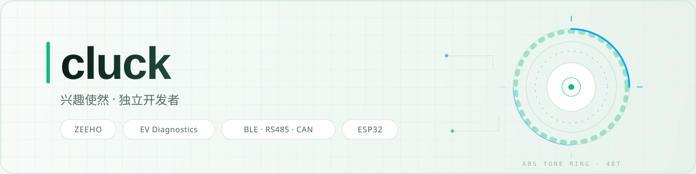

<picture>
  <source media="(prefers-color-scheme: dark)" srcset="https://raw.githubusercontent.com/cluck798/cluck798/main/assets/banner-dark.svg">
  <source media="(prefers-color-scheme: light)" srcset="https://raw.githubusercontent.com/cluck798/cluck798/main/assets/banner-light.svg">
  
</picture>

## 关于

兴趣使然，做点能用的小工具。

- 折腾极核 ZEEHO 电动摩托车的车机、诊断与改装
- 玩 BLE / RS485 / CAN 总线抓包、协议逆向与固件分析
- 习惯把摸清楚的协议，做成别人能直接上手的工具

## 精选项目

<table>
  <tr>
    <td width="50%" valign="top">
      <h3><a href="https://github.com/cluck798/ZEEHO">ZEEHO</a></h3>
      
极核多账号签到面板，代理脚本版 + Windows 桌面版。

      
<code>JavaScript</code> <code>Windows</code> <code>Proxy</code>

      

        
        
      

    </td>
    <td width="50%" valign="top">
      <h3><a href="https://github.com/cluck798/zeeho-diag">zeeho-diag</a></h3>
      
ZEEHO 无线诊断工具包：iOS BLE 诊断 App（RS485/CAN）+ ESP32 CAN 桥固件。

      
<code>iOS</code> <code>ESP32</code> <code>CAN</code>

      

        
        
      

    </td>
  </tr>
  <tr>
    <td width="50%" valign="top">
      <h3><a href="https://github.com/cluck798/zeeho-abs-ring">zeeho-abs-ring</a></h3>
      
ABS 齿圈计算器：按轮胎规格推算信号齿圈的齿数。

      
<code>Tool</code> <code>Calculator</code>

      

        
      

    </td>
    <td width="50%" valign="top">
      <h3><a href="https://github.com/cluck798?tab=repositories">更多项目</a></h3>
      
还有几个自用的小工具与镜像备份，都在仓库列表里。

      
<code>All Repositories</code>

      
<a href="https://github.com/cluck798?tab=repositories">查看全部仓库 →</a>

    </td>
  </tr>
</table>

## 技术栈

<strong>开发</strong>

  
  
  
  
  
  
  

<strong>硬件与协议</strong>

  
  
  
  

<strong>工具</strong>

  
  
  
  
  

## 数据面板

 

 

## 贡献图

<picture>
  <source media="(prefers-color-scheme: dark)" srcset="https://raw.githubusercontent.com/cluck798/cluck798/output/snake-dark.svg">
  <source media="(prefers-color-scheme: light)" srcset="https://raw.githubusercontent.com/cluck798/cluck798/output/snake.svg">
  
</picture>

 

兴趣使然 · 保持好奇

